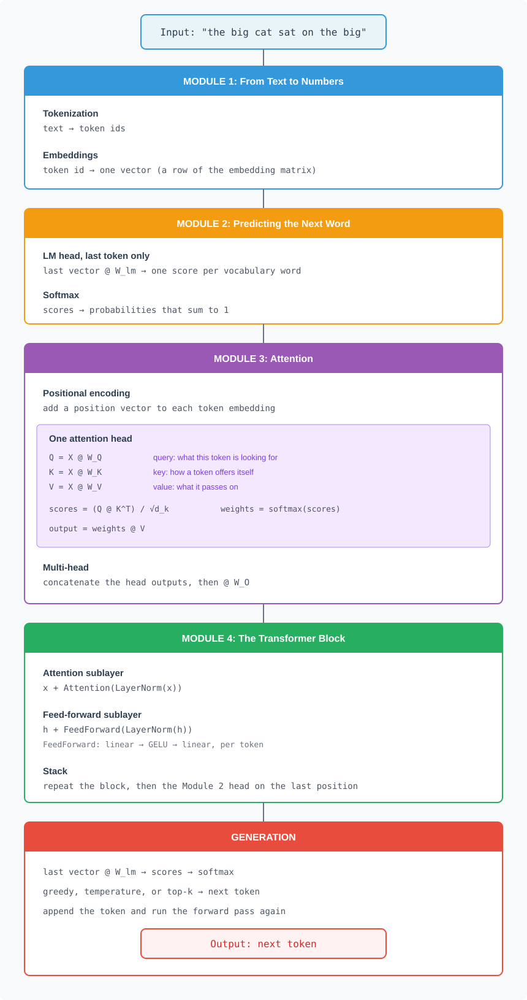

# The pipeline

Every next-word prediction follows one path. This figure is the map for the rest of the course. Later lessons open one box each.

1. **Tokenization** turns text into token ids.
2. **Embeddings** turn each id into a vector.
3. **Transformer blocks** repeat. Inside a block, attention relates the tokens, then a feed-forward network updates each token.
4. **The LM head** turns the final vectors into one score per vocabulary word. **Softmax** turns those scores into probabilities.

Positional encoding is drawn with attention, in Module 3. Layer norm and residual connections are drawn with the full block, in Module 4. The bottom box, generation, is the loop that appends the chosen token and runs this path again. That loop is Module 4.

Next: [Training and inference](<Training vs Inference.md>)
