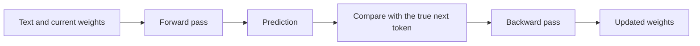

# Training and inference

The path from input text to a next-word prediction is the forward pass. A chat model runs that pass with weights that stay fixed. That use is inference.

Before training, those weights are random numbers, and the forward pass produces nonsense. Training shows the model many texts, compares each prediction with the true next token, and adjusts the weights.

The adjustment needs the backward pass. Backpropagation computes how each weight contributed to the error. It stores intermediate values from the forward pass and walks back through every layer.

Inference is the forward box alone. The weights stay as training left them.

This course stays on the forward pass. A full training run adds a loss function, gradients, and an optimizer on top of the same computation.

Next: [Vectors and the dot product](<../Linear Algebra Basics/Vectors and the Dot Product.md>)
