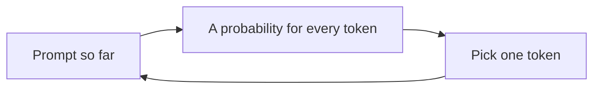

# What an LLM does

Type "The capital of Vietnam" into a chat model and it answers "Hanoi". The model receives text and returns text.

The mechanism is next-word prediction. The model assigns a probability to every token it knows, picks one, appends it to the prompt, and predicts again.

## One next word

Given "The cat sat on the", a model that has learned English puts high probability on continuations such as "mat" and "floor", a medium probability on "table", and a very small probability on "banana".

The distribution covers the whole vocabulary, often 50,000 to 100,000 tokens. The chosen token is added to the input, and the same step runs until the reply is complete.

## Where the pattern comes from

The model has seen a huge amount of text. Sentences like "The capital of Vietnam is Hanoi" occur many times. The link between those words is a statistical pattern, in the same way that "once upon a time" marks the opening of a story after enough stories. There is no stored table of facts to look up.

## Limits

- Knowledge stops at the training cutoff. News, prices, and private data are visible only when that text is placed in the prompt.
- A sentence can sound sure and still be wrong. The model continues patterns from its training text, including patterns taken from unreliable pages.
- The same prompt can yield different replies. The step that turns the probabilities into a single token can sample at random.

Next: [The pipeline](Pipeline.md)
