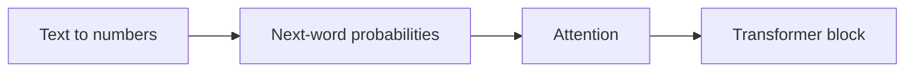

# Introduction

Chat models take a prompt and return text. Used as a finished service, that exchange is a black box: when the reply is nonsense, or when a product needs a specific behavior, there is little to inspect.

This course opens that box one stage at a time. The notes follow the forward pass, from text to one next-word distribution. They do not train a model. Where a number needs checking, the lesson includes a short NumPy snippet.

1. **Text to numbers.** Split the text into tokens and turn each token into a vector.
2. **Predicting the next word.** Turn the last vector into a probability for every word in the vocabulary.
3. **Attention.** Let every token look at the other tokens, so a prediction can depend on earlier words.
4. **The transformer.** Stack that idea into a stable block, then generate text one token at a time.

The design comes from [Attention Is All You Need](https://arxiv.org/abs/1706.03762). The last lesson points each section of the paper back at the lesson that covers it.

Next: [What an LLM does](<Fundamentals/What an LLM Does.md>)
