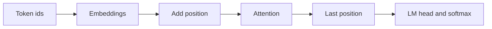

# A context-aware predictor

The forward pass for this module stacks the pieces that already exist. Embeddings, plus a position vector, plus attention, plus the LM head and softmax from Module 2. The head reads the last position.



For `the big cat sat on the big ___`, the last position's vector can carry information from the earlier `big`, because a head can put weight there. The distribution is no longer "whatever follows the word big." The blank is solvable in principle. These notes do not train the weights that would solve it.

On a full prefix, each position may attend only to itself and earlier positions. Positions ahead of it are the tokens the model is still trying to predict. Set those scores to a large negative number before softmax and their weights become zero.

```python
import numpy as np

scores = np.zeros((4, 4))
future = np.triu(np.ones((4, 4)), k=1)
scores = scores - 1e9 * future
print(scores)
# row i keeps columns 0..i, and the rest are about -1e9
```

This assembly has no layer norm, no residual connection, and no feed-forward network. Those belong to the block in Module 4.

Next: [Residuals and layer norm](<../Module 4/Residuals and Layer Norm.md>)
