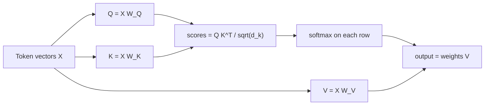

# One attention head

One head turns a matrix of token vectors into a new matrix of the same shape. Each output row is a weighted sum of the value vectors. The weights come from comparing queries and keys.

Three matrices, from the token matrix `X`:

- A **query** is what this token is looking for: `Q = X @ W_Q`.
- A **key** is how a token offers itself to be found: `K = X @ W_K`.
- A **value** is what it passes on if it is selected: `V = X @ W_V`.



This sketch uses 3 tokens and `d_model = 4`. With one head, `d_k = 4`, so `sqrt(d_k) = 2`.

```text
X has shape (3, 4)
Q = X @ W_Q      W_Q is (4, 4), so Q is (3, 4)
K = X @ W_K      K is (3, 4)
V = X @ W_V      V is (3, 4)
scores = (Q @ K^T) / sqrt(d_k)    scores are (3, 3)
weights = softmax(scores)         softmax over the key axis
output = weights @ V              output is (3, 4)
```

Each score is a dot product between one query row and one key row, divided by 2. Softmax is the same function as in Module 2, applied to each row of scores so that row sums to 1.

In the numbers below, `W_Q` and `W_K` are the identity, so `Q` and `K` equal `X`. That makes one score easy to check by hand. Real models learn all three weight matrices.

```python
import numpy as np

X = np.array([
    [1.0, 0.0, 1.0, 0.0],  # the
    [0.0, 1.0, 0.0, 1.0],  # big
    [1.0, 1.0, 0.0, 0.0],  # cat
])
W_Q = np.eye(4)
W_K = np.eye(4)
W_V = np.array([
    [1.0, 0.0, 0.0, 0.0],
    [1.0, 0.0, 0.0, 0.0],
    [0.0, 1.0, 0.0, 0.0],
    [0.0, 0.0, 1.0, 0.0],
])

Q = X @ W_Q
K = X @ W_K
V = X @ W_V
scores = (Q @ K.T) / np.sqrt(4)

def softmax_rows(m):
    shifted = m - m.max(axis=1, keepdims=True)
    e = np.exp(shifted)
    return e / e.sum(axis=1, keepdims=True)

weights = softmax_rows(scores)
output = weights @ V
```

The score in row 0, column 2 is the first query dotted with the third key, then divided by 2: `[1, 0, 1, 0] · [1, 1, 0, 0] / 2 = 0.5`.

```text
scores
[[1.  0.  0.5]
 [0.  1.  0.5]
 [0.5 0.5 1. ]]

weights
[[0.5065 0.1863 0.3072]
 [0.1863 0.5065 0.3072]
 [0.2741 0.2741 0.4519]]

output
[[1.3072 0.5065 0.1863 0.    ]
 [1.3072 0.1863 0.5065 0.    ]
 [1.4519 0.2741 0.2741 0.    ]]
```

Row 0 of `weights` says the first token takes about half of its new vector from the first value, about 0.19 from the second, and about 0.31 from the third. The output is still `(3, 4)`, one vector per token.

Next: [Multi-head attention](<Multi-Head Attention.md>)
