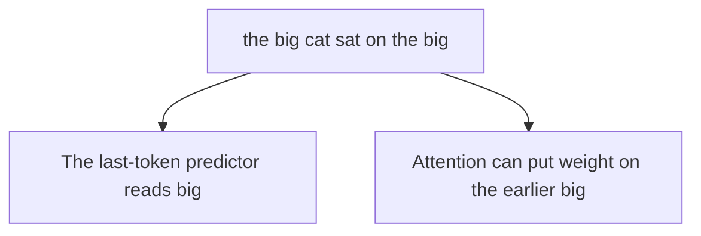

# Why the last token is not enough

The last-word predictor answers `the big cat sat on the big ___` from `big` alone. The earlier `big` is in the prefix, and nothing in that formula points back to it. A prefix that ends in the same word gets the same distribution.

Attention replaces that single-token read with a weighted view of every token, including the token itself. Each position mixes information from the positions it weights. The next lesson is the formula for one head.

Next: [One attention head](<One Attention Head.md>)
