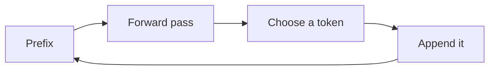

# Generation

Autoregressive decoding turns one next-token distribution into a string. Pick a token, append it to the input, run the forward pass again, and stop at an end token or a length limit.



The three choice rules below share the logits from the softmax lesson: `[2, 1, 0, -1, -2]` for `mat`, `floor`, `table`, `banana`, `hat`. Temperature uses that same softmax on logits divided by `T`.

```python
import numpy as np

np.set_printoptions(precision=4, suppress=True)
words = np.array(["mat", "floor", "table", "banana", "hat"])
logits = np.array([2.0, 1.0, 0.0, -1.0, -2.0])

def softmax(z):
    z = np.asarray(z, dtype=float)
    z = z - np.max(z)
    e = np.exp(z)
    return e / e.sum()

print("greedy", words[int(logits.argmax())])          # mat

print("T=0.5", np.round(softmax(logits / 0.5), 4))
# [0.8647 0.117  0.0158 0.0021 0.0003]
print("T=2", np.round(softmax(logits / 2.0), 4))
# [0.4287 0.26   0.1577 0.0956 0.058 ]

top_k = logits.copy()
top_k[np.argsort(top_k)[:-2]] = -np.inf
print("top-2", np.round(softmax(top_k), 4))
# [0.7311 0.2689 0. 0. 0.]

rng = np.random.default_rng(0)
print(rng.choice(words, size=5, p=softmax(logits)))
# ['floor' 'mat' 'mat' 'mat' 'floor']
```

- **Greedy** is argmax, the same rule as Module 2. Here it always picks `mat`.
- **Temperature** divides the logits by `T` before softmax. `T = 0.5` sharpens the distribution: `mat` rises from about 0.636 to about 0.865. `T = 2` flattens it: `mat` falls to about 0.429, and `table` rises to about 0.158.
- **Top-k** keeps the `k` largest logits, sets the rest to negative infinity, then uses softmax and samples. With `k = 2`, only `mat` and `floor` remain, at about 0.731 and 0.269.

Top-p keeps the smallest set of tokens whose probabilities sum to at least `p`.

Five draws at `T = 1` with a fixed random seed come out `floor`, `mat`, `mat`, `mat`, `floor`. The same logits, a different choice rule, a different string.

Next: [Paper map](<Paper Map.md>)
