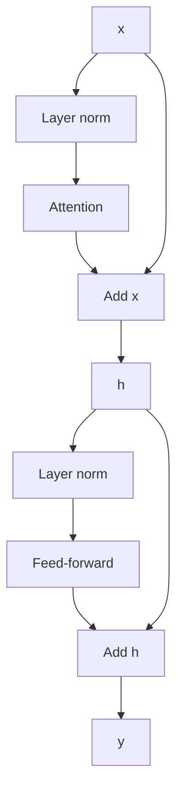

# One block, then a stack

A block is the residual layer-norm sandwich around attention, then the same sandwich around the feed-forward network.

```text
h = x + Attention(LayerNorm(x))
y = h + FeedForward(LayerNorm(h))
```



Stack two of these. The tiny picture is 2 blocks and 4 heads. A large model repeats the same block many more times: GPT-2 uses 12, GPT-3 uses 96.

Take the last position of the last block and multiply by `W_lm`, then softmax, exactly as in Module 2. If each block preserves `d_model`, the shapes through the stack are:

```text
embeddings            (n_tokens, d_model)
block 1 output        (n_tokens, d_model)
block 2 output        (n_tokens, d_model)
last position         (d_model,)
logits = last @ W_lm  (vocab,)
```

Next: [Generation](Generation.md)
