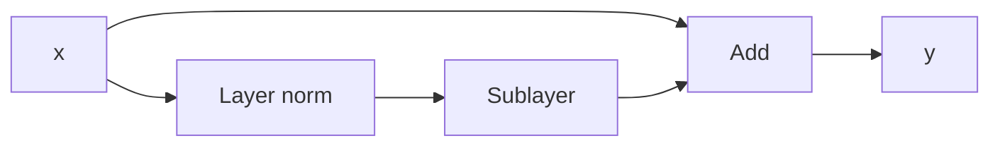

# Residuals and layer norm

A stack of blocks is trainable when each block keeps a clean path for its input and keeps the magnitudes under control. The two pieces do that together.

The order in the block is: layer norm, then the sublayer, then the residual add.

```text
y = x + Sublayer(LayerNorm(x))
```

The residual add writes `x + Sublayer(...)`. The original token vector still has a path forward. Layer norm rescales one token's features so a few large numbers do not dominate the next layer.



Take `x = [1, 0, 0, 1]`. Its mean is 0.5 and its variance is 0.25, so layer norm (ignoring the tiny epsilon that keeps the division safe) is `[1, -1, -1, 1]`. Mean 0, values on a shared scale.

Suppose the sublayer then returns `[0, 0.5, 0, 0]`. The add puts the original `x` back:

```text
before the sublayer     [1, 0, 0, 1]
after layer norm        [1, -1, -1, 1]
sublayer output         [0, 0.5, 0, 0]
after the add           [1, 0.5, 0, 1]
```

```python
import numpy as np

x = np.array([1.0, 0.0, 0.0, 1.0])
normalized = (x - x.mean()) / np.sqrt(x.var() + 1e-5)
sublayer_out = np.array([0.0, 0.5, 0.0, 0.0])
y = x + sublayer_out
print(np.round(normalized, 4))  # [1, -1, -1, 1]
print(y)                        # [1, 0.5, 0, 1]
```

The sublayer in this sketch is a stand-in. In the block it is attention, and then the feed-forward network, each with its own norm and its own add.

Next: [The feed-forward network](<Feed-Forward.md>)
